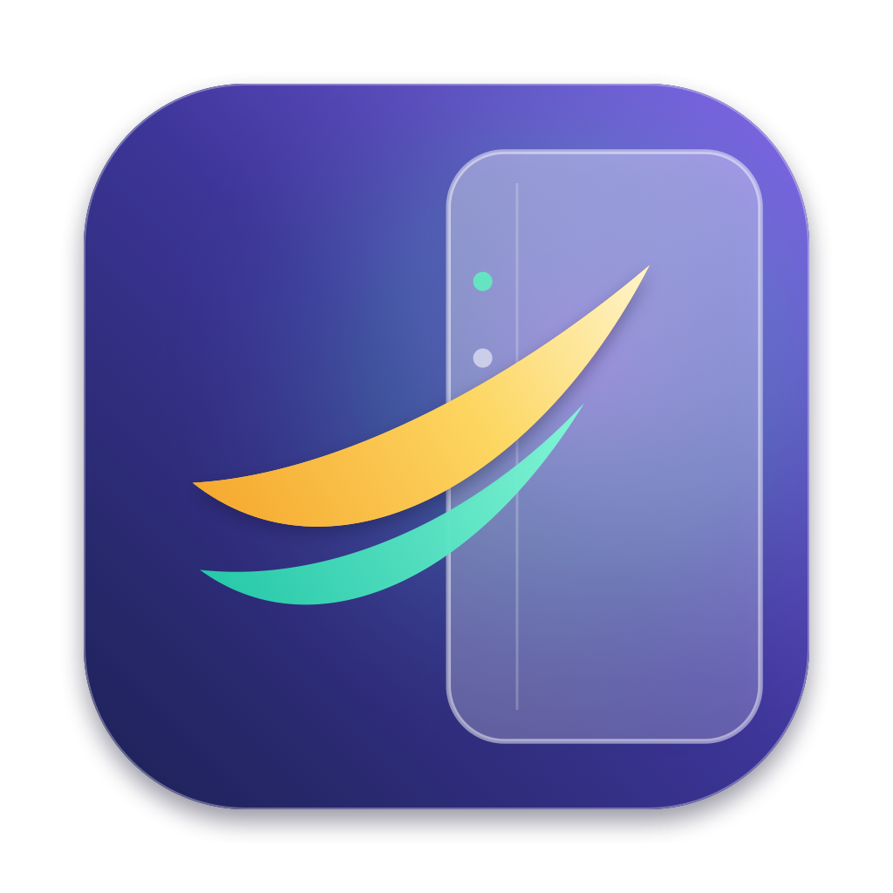

<p align="center">
  
</p>

<h1 align="center">Veypane</h1>

<p align="center">
  A native macOS slide-over browser that glides in from the edge of your screen without disturbing your windows.
</p>

<p align="center">
  
</p>

## Features

- **Edge & Hotkey Slide-Over**: Floating rounded vibrancy panel triggered from a screen edge, corner, menu bar icon, or global shortcut (`⌃\``), with smooth animations and Reduce Motion support.
- **Persistent Multi-Pad Workspace**: Keep web apps alive in a customizable sidebar rail with favicons, unread badges, isolated browser profiles (`WKWebsiteDataStore`), and configurable page retention.
- **Distraction-Free Chrome**: Compact URL-free header with a transient `⌘L` address overlay, per-site sizing, custom User-Agent presets, content blocking, and per-URL CSS/JS rules.
- **Web Extensions (macOS 15.4+)**: Load Manifest V2 & V3 extensions from unpacked folders, `.zip`/`.crx` archives, or installed Safari Web Extensions via `WKWebExtension`.
- **Local Automation**: Control Veypane with `veypanectl`, `veypane://` URLs, Apple Shortcuts, and an opt-in token-authenticated `127.0.0.1` HTTP + MCP server.

## Requirements

- macOS 14.0 or later (macOS 15.4+ for browser extensions)
- Xcode with Swift 6.2 toolchain (to build from source)

## Build & Install

```bash
export DEVELOPER_DIR=/Applications/Xcode.app/Contents/Developer
swift build -c release && swift test
./scripts/bundle.sh
```

`./scripts/bundle.sh` builds in release mode and writes `./Veypane.app` and `./Veypane.zip` in the repository root (or `$OUTPUT_DIR` if set).

Install and launch the bundled app:

```bash
cp -R ./Veypane.app /Applications/Veypane.app
open /Applications/Veypane.app
```

Alternatively, run `./scripts/install-upgrade.sh --launch` to back up any existing `/Applications/Veypane.app` before copying and launching the new build.

## Quick Usage

- Press **`⌃\``** (or move your pointer to the configured screen edge) to slide Veypane in or out.
- Press **`⌘L`** to open the transient address bar, **`⌘T`** to add a pad, and **`⌘1`–`⌘9`** to switch pads.
- Control Veypane from the terminal using the built CLI binary (`.build/release/veypanectl`, also bundled at `Veypane.app/Contents/MacOS/veypanectl`) or `veypane://` URLs:

```bash
.build/release/veypanectl toggle
.build/release/veypanectl add https://docs.swift.org --title "Swift Docs"
.build/release/veypanectl open https://webkit.org --pad "Swift Docs"
```

```text
veypane://toggle
veypane://open?url=https%3A%2F%2Fswift.org&pad=Search
```

## License

Licensed under the [MIT License](LICENSE) (`Copyright (c) 2026 Lorin Lee`).

Apple system frameworks, WebKit, and Apple SF Symbols are not included in this repository and are not relicensed under MIT — see [NOTICE.md](NOTICE.md) and [Assets/README.md](Assets/README.md).
